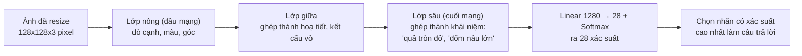
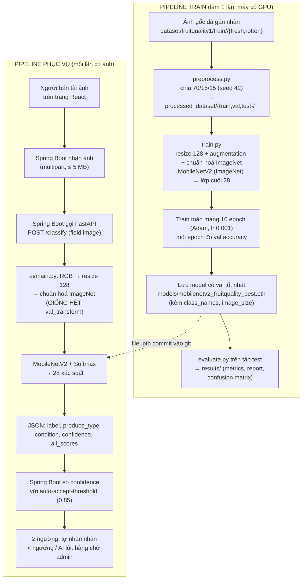

# Giải thích chi tiết phần AI — Phân loại chất lượng nông sản qua ảnh

Tài liệu này viết cho người **chưa từng học AI**. Đọc xong bạn sẽ hiểu: bài toán đang giải là gì, các
thuật ngữ nghĩa là gì, vì sao chọn MobileNetV2 (so với các lựa chọn khác), model hiện tại đạt kết quả ra
sao, luồng chạy đầy đủ từ ảnh thô đến kết quả trên web, và mỗi bước nằm ở file nào trong repo để tự tra.

> Tài liệu song song: [`ai/README.md`](../README.md) là hướng dẫn **thao tác nhanh** (lệnh chạy cụ thể).
> File này là bản **giải thích khái niệm đầy đủ** — khi README nói "làm X" mà không rõ tại sao, quay lại đây.
>
> Cập nhật 12/10/2026: viết lại cho bản **PyTorch** do Duy train (28 lớp, accuracy 96,78%), thay bản khung
> TensorFlow/Keras 6 lớp chạy giả lập trước đây.

## Mục lục

1. [Bài toán đang giải là gì](#1-bài-toán-đang-giải-là-gì)
2. [Từ điển thuật ngữ](#2-từ-điển-thuật-ngữ-tra-khi-gặp-từ-lạ)
3. [CNN — cách máy "nhìn" một tấm ảnh](#3-cnn--cách-máy-nhìn-một-tấm-ảnh)
4. [Transfer Learning là gì, nhóm đã dùng theo cách nào](#4-transfer-learning-là-gì-nhóm-đã-dùng-theo-cách-nào)
5. [MobileNetV2 là gì, cấu tạo bên trong](#5-mobilenetv2-là-gì-cấu-tạo-bên-trong)
6. [Vì sao chọn MobileNetV2 — so sánh có số liệu](#6-vì-sao-chọn-mobilenetv2--so-sánh-có-số-liệu)
7. [So sánh với các hướng giải pháp khác (ngoài CNN)](#7-so-sánh-với-các-hướng-giải-pháp-khác-ngoài-cnn)
8. [Kết quả model hiện tại & cách đọc](#8-kết-quả-model-hiện-tại--cách-đọc)
9. [Pipeline đầy đủ: từ ảnh thô đến JSON trả về web](#9-pipeline-đầy-đủ-từ-ảnh-thô-đến-json-trả-về-web)
10. [Bản đồ: bước nào nằm ở file nào](#10-bản-đồ-bước-nào-nằm-ở-file-nào)
11. [Lỗi thường gặp & cách tự sửa](#11-lỗi-thường-gặp--cách-tự-sửa)
12. [Tài liệu tham khảo chính thức](#12-tài-liệu-tham-khảo-chính-thức)

---

## 1. Bài toán đang giải là gì

**Input:** 1 tấm ảnh quả/rau người bán chụp và tải lên.
**Output:** 1 JSON gồm — loại nông sản (táo, chuối, cà chua...), tình trạng (tươi/hỏng), và **độ tin cậy**
(model tự tin bao nhiêu về câu trả lời đó, từ 0 đến 1).

Đây là bài toán **phân loại ảnh (image classification)**: đưa ảnh vào, model chọn 1 trong N nhãn đã biết
trước. Model hiện tại có **N = 28 nhãn** = 14 loại nông sản × 2 tình trạng:

| Loại (tên trong model) | Tiếng Việt | Loại | Tiếng Việt |
|---|---|---|---|
| `apple` | táo | `mango` | xoài |
| `banana` | chuối | `orange` | cam |
| `bellpepper` | ớt chuông | `pomegranate` | lựu |
| `carrot` | cà rốt | `potato` | khoai tây |
| `cucumber` | dưa leo | `strawberry` | dâu tây |
| `grape` | nho | `tomato` | cà chua |
| `guava` | ổi | `jujube` | táo tàu |

Mỗi loại có 2 nhãn `_fresh` (tươi) và `_rotten` (hỏng), ví dụ `tomato_fresh`, `tomato_rotten`. Model
**không** tự nghĩ ra nhãn mới — ảnh mít, ảnh sầu riêng... vẫn sẽ bị ép vào 1 trong 28 nhãn trên (thường với
độ tin cậy thấp, xem [mục 8](#8-kết-quả-model-hiện-tại--cách-đọc)).

Khác với lập trình thông thường (viết luật `if-else`), ở đây ta **không tự viết luật phân biệt "tươi vs
hỏng"** — đặc điểm ảnh thực tế quá đa dạng (góc chụp, ánh sáng, giống quả...) để liệt kê bằng tay. Thay vào
đó, ta cho máy xem **hàng chục nghìn ảnh mẫu đã gắn nhãn sẵn**, và thuật toán học máy tự tìm ra quy luật
phân biệt. Quá trình "tự tìm quy luật từ dữ liệu mẫu" đó gọi là **huấn luyện (training)**.

## 2. Từ điển thuật ngữ (tra khi gặp từ lạ)

| Thuật ngữ | Giải thích dễ hiểu |
|---|---|
| **AI / Machine Learning (Học máy)** | Máy tự học quy luật từ dữ liệu mẫu, thay vì con người viết sẵn luật. |
| **Deep Learning (Học sâu)** | Nhánh của Machine Learning dùng **mạng nơ-ron nhiều lớp** để học. CNN nằm trong nhánh này. |
| **Neural Network (Mạng nơ-ron)** | Nhiều lớp tính toán xếp chồng, mỗi lớp nhận đầu ra lớp trước, biến đổi rồi đưa cho lớp sau. Bản chất chỉ là các phép nhân-cộng ma trận số. |
| **Layer (Lớp)** | 1 bước biến đổi trong mạng. MobileNetV2 có vài chục lớp tích chập xếp chồng (xem mục 5). |
| **Weight / Parameter (Trọng số)** | Những con số bên trong mỗi lớp, quyết định lớp đó tính toán ra sao. Đây là thứ được **học** lúc training — "train xong" nghĩa là các con số này đã được tối ưu để trả lời đúng. |
| **CNN (Convolutional Neural Network)** | Mạng nơ-ron chuyên xử lý ảnh, dùng phép "tích chập" để quét ảnh tìm đặc điểm. Xem [mục 3](#3-cnn--cách-máy-nhìn-một-tấm-ảnh). |
| **Convolution / Filter / Kernel** | Một "cửa sổ" nhỏ (VD 3×3 pixel) trượt qua ảnh để dò 1 đặc điểm (cạnh dọc, mảng màu nâu...). |
| **Feature map** | Kết quả sau khi 1 filter quét xong ảnh — "bản đồ" cho biết đặc điểm đó xuất hiện đậm/nhạt ở đâu. |
| **Fully Connected / Linear layer** | Lớp "tổng hợp" cuối mạng, gộp mọi đặc điểm đã dò được để ra quyết định thuộc lớp nào. Trong code là `nn.Linear(1280, 28)`: 1280 đặc điểm vào → 28 điểm số ra. |
| **Softmax** | Hàm biến 28 điểm số thô thành 28 xác suất cộng lại = 1. Xác suất lớn nhất chính là `confidence` trả về cho backend. |
| **Loss function (hàm mất mát)** | Thước đo "model đang sai bao nhiêu" so với nhãn thật. Train = chỉnh weight để loss nhỏ dần. Ở đây dùng `nn.CrossEntropyLoss` (chuẩn cho phân loại nhiều lớp). |
| **Optimizer** | Thuật toán chỉnh weight để giảm loss. Ở đây dùng **Adam** (phổ biến nhất hiện nay). |
| **Epoch** | 1 lượt cho model xem **hết** ảnh train 1 lần. `train.py` chạy 10 epoch. |
| **Batch / Batch size** | Model xử lý theo từng "lô" ảnh. `BATCH_SIZE = 32` = mỗi lần chỉnh weight dựa trên 32 ảnh. |
| **Learning rate** | Mỗi lần chỉnh weight thì chỉnh "mạnh tay" hay "nhẹ tay". Quá lớn → học loạn; quá nhỏ → học cực chậm. `train.py` dùng `0.001`. |
| **Overfitting (học vẹt)** | Model thuộc lòng ảnh train (kể cả nhiễu) thay vì học quy luật chung → ảnh train đúng gần hết nhưng ảnh mới sai nhiều. Chống bằng Data Augmentation, theo dõi độ chính xác trên tập **val**, giữ model có val tốt nhất. |
| **Data Augmentation** | Biến đổi ngẫu nhiên ảnh train (lật ngang, xoay ±15°, đổi sáng/tương phản) để tạo thêm biến thể, model không học vẹt theo góc chụp cố định. Chỉ làm lúc train, **không** làm lúc dự đoán. |
| **Pretrained model** | Model người khác đã train sẵn trên bộ dữ liệu khổng lồ, tải về dùng lại miễn phí. Ở đây là MobileNetV2 train sẵn trên **ImageNet**, lấy từ thư viện `torchvision`. |
| **ImageNet** | Bộ dữ liệu ~14 triệu ảnh, 1000 loại vật thể — chuẩn "sát hạch" cho gần như mọi model ảnh. Model train trên ImageNet đã "biết nhìn" hình dạng/màu sắc/kết cấu nói chung. |
| **Transfer Learning (học chuyển giao)** | Tận dụng pretrained model rồi dạy thêm cho bài toán riêng, thay vì train từ đầu. Xem [mục 4](#4-transfer-learning-là-gì-nhóm-đã-dùng-theo-cách-nào). |
| **Fine-tuning** | Cho phép chỉnh lại cả weight của phần pretrained (không chỉ lớp cuối) để khớp bài toán của mình. Nhóm fine-tune **toàn bộ mạng** (mục 4). |
| **Normalization (chuẩn hoá)** | Đưa giá trị pixel về cùng thang đo model quen. Ở đây trừ trung bình và chia độ lệch chuẩn của ImageNet (`mean=[0.485, 0.456, 0.406]`, `std=[0.229, 0.224, 0.225]`) — bắt buộc vì weight pretrained đã học trên ảnh chuẩn hoá đúng như vậy. |
| **Inference (suy luận / dự đoán)** | Lúc **dùng** model đã train để đoán ảnh mới. Đây là việc FastAPI làm mỗi khi backend gửi ảnh sang. |
| **Confidence (độ tin cậy)** | Xác suất (0–1) của nhãn model chọn. Backend so với ngưỡng 0.85: ≥ ngưỡng tự nhận nhãn, < ngưỡng đưa admin xem. |
| **Train / Val / Test set** | **Train** = ảnh dạy model (70%). **Val** = ảnh để chọn model tốt nhất giữa các epoch (15%). **Test** = ảnh tách riêng, chỉ dùng 1 lần cuối để đo thật model giỏi tới đâu (15%). Con số 96,78% là đo trên **test**. |
| **Accuracy / Precision / Recall / F1** | Accuracy = % ảnh đoán đúng. Với 1 lớp X: **Precision** = trong các ảnh model bảo là X, bao nhiêu % đúng là X; **Recall** = trong các ảnh thật sự là X, model bắt được bao nhiêu %; **F1** = trung bình hài hoà của 2 số đó. |
| **Confusion matrix** | Bảng 28×28: hàng = nhãn thật, cột = nhãn model đoán. Đường chéo đậm = đoán đúng; ô lệch đường chéo cho biết model hay nhầm lớp nào sang lớp nào. File `results/confusion_matrix.png`. |
| **GPU / CPU / CUDA** | GPU tính song song rất nhanh, phù hợp **train**. CUDA là công nghệ để PyTorch dùng GPU NVIDIA. Code tự dùng GPU nếu có, không thì CPU. Lúc **dự đoán** 1 ảnh 128×128 thì CPU là đủ. |
| **Tensor** | Mảng số nhiều chiều — cách PyTorch biểu diễn ảnh, weight... Ảnh vào model là tensor kích thước `[1, 3, 128, 128]` (1 ảnh, 3 kênh màu, cao, rộng). |
| **PyTorch / torchvision** | PyTorch: thư viện deep learning (của Meta). torchvision: thư viện đi kèm, có sẵn model ảnh pretrained (`models.mobilenet_v2`) và các phép biến đổi ảnh (`transforms`). |
| **`.pth` file (checkpoint)** | File lưu weight đã học (`state_dict`) + thông tin kèm theo. File của nhóm lưu thêm `class_names` (28 nhãn theo đúng thứ tự), `num_classes`, `image_size` — nên lúc phục vụ không phải chép tay danh sách nhãn. |
| **API / REST API / FastAPI** | Cách 2 chương trình (Spring Boot và Python) nói chuyện qua HTTP bằng JSON. FastAPI là framework Python "khoác áo" cho model thành dịch vụ nhận ảnh, trả JSON, có trang thử tại `/docs`. |

## 3. CNN — cách máy "nhìn" một tấm ảnh

Với máy tính, 1 tấm ảnh chỉ là lưới số (mỗi pixel = 3 số Đỏ-Xanh lá-Xanh dương). CNN xử lý lưới số đó
qua nhiều lớp, mỗi lớp học một mức đặc điểm sâu hơn lớp trước:



Điểm mấu chốt: **không ai lập trình sẵn "lớp nông tìm cạnh"** — toàn bộ filter được **tự học** từ dữ liệu
(tối ưu loss bằng optimizer qua nhiều epoch). Ta chỉ chọn *hình dạng* mạng, còn *nội dung* các filter do
quá trình train tìm ra.

## 4. Transfer Learning là gì, nhóm đã dùng theo cách nào

**Vấn đề:** để CNN tự học "biết nhìn" từ con số 0 (weight ngẫu nhiên) cần hàng trăm nghìn đến hàng triệu
ảnh và nhiều ngày train trên GPU mạnh. Dataset của nhóm khoảng 29 nghìn ảnh (tập test 4.410 ảnh = 15%) —
train từ đầu dễ học vẹt hoặc kém chính xác.

**Giải pháp — Transfer Learning:** bắt đầu từ MobileNetV2 đã train sẵn trên ImageNet (đã biết phân biệt
"tròn vs dài", "đỏ vs nâu", "trơn vs sần"...), rồi dạy thêm cho 28 nhãn của mình. Có 2 cách phổ biến:

| Cách | Làm gì | Khi nào hợp |
|---|---|---|
| **A. Đóng băng (feature extraction)** | Khoá toàn bộ phần pretrained, chỉ train lớp cuối mới thêm. | Dataset nhỏ (vài trăm – vài nghìn ảnh), máy yếu. |
| **B. Fine-tune toàn bộ** ✅ (nhóm đang dùng) | Thay lớp cuối, rồi train **toàn bộ** mạng — weight ImageNet chỉ là điểm xuất phát tốt, được chỉnh tiếp. | Dataset đủ lớn (hàng chục nghìn ảnh) — mạng có đủ dữ liệu để chỉnh mà không phá hỏng kiến thức cũ. |

Cụ thể trong [`training/train.py`](../training/train.py) mục 8–9:

```python
model = models.mobilenet_v2(weights="DEFAULT")          # nạp weight ImageNet
model.classifier[1] = nn.Linear(model.classifier[1].in_features, num_classes)   # 1000 lớp → 28 lớp
optimizer = torch.optim.Adam(model.parameters(), lr=LEARNING_RATE)              # model.parameters() = TOÀN BỘ mạng
```

Ví dụ dễ hình dung: thuê một người **đã biết nhìn hàng nghìn loại vật thể**, rồi cho người đó xem ~20 nghìn
ảnh nông sản có đáp án để luyện tiếp — nhanh hơn rất nhiều so với dạy một người chưa từng nhìn thấy gì.

## 5. MobileNetV2 là gì, cấu tạo bên trong

**MobileNetV2** là kiến trúc CNN do Google công bố năm 2018, thiết kế **chạy nhẹ, nhanh** trên thiết bị yếu
(điện thoại, máy không có GPU) mà vẫn giữ độ chính xác gần các mạng nặng hơn nhiều. Bài báo gốc:
*"MobileNetV2: Inverted Residuals and Linear Bottlenecks"* — Sandler và cộng sự, CVPR 2018.

2 ý tưởng cốt lõi làm nó nhẹ (chỉ cần hiểu ý tưởng, không cần công thức):

- **Depthwise Separable Convolution** — tích chập thường xử lý mọi kênh màu và mọi bộ lọc trong 1 phép toán
  lớn. MobileNetV2 **tách làm 2 bước nhỏ**: quét từng kênh riêng, rồi trộn các kênh bằng phép 1×1. Giảm số
  phép tính khoảng **8–9 lần**, kết quả gần tương đương.
- **Inverted Residual + Linear Bottleneck** — mỗi khối "phình to" số kênh để trích đặc điểm phong phú rồi
  "nén lại" trước khi sang khối sau (ngược cách truyền thống, nên gọi là "Inverted"). Giữ đủ thông tin mà
  tiết kiệm bộ nhớ.

Kết quả: bản gốc chỉ **~3,5 triệu tham số**. Bản của nhóm thay lớp cuối 1000 → 28 lớp nên còn ít hơn — file
`.pth` chỉ **~9 MB**, dự đoán 1 ảnh trên CPU mất vài chục mili-giây. Không cần server GPU lúc phục vụ (GPU
chỉ cần lúc **train**).

## 6. Vì sao chọn MobileNetV2 — so sánh có số liệu

Số liệu từ Keras Applications (`keras.io/api/applications`, đánh giá trên tập validation ImageNet — cùng 1
chuẩn cho mọi model nên so sánh công bằng). Đây là đặc tính của **kiến trúc**, không phụ thuộc framework —
bản trong `torchvision` mà nhóm dùng có số liệu tương đương.

| Model | Kích thước file | Top-1 Accuracy | Số tham số | Nhận xét |
|---|---|---|---|---|
| **MobileNetV2** ✅ (đang dùng) | **14 MB** | 71.3% | **3.5 triệu** | Nhẹ nhất bảng, đủ chính xác |
| MobileNet (v1) | 16 MB | 70.4% | 4.3 triệu | Bản cũ, MobileNetV2 vượt cả 2 mặt |
| VGG16 | 528 MB | 71.3% | 138.4 triệu | **Chính xác bằng nhưng nặng gấp 37 lần** |
| ResNet50 | 98 MB | 74.9% | 25.6 triệu | Chính xác hơn ~3.6%, nặng gấp 7 lần |
| InceptionV3 | 92 MB | 77.9% | 23.9 triệu | Chính xác hơn ~6.6%, nặng gấp 6.5 lần |
| Xception | 88 MB | 79.0% | 22.9 triệu | Chính xác nhất bảng nhưng nặng gấp 6 lần |
| EfficientNetB0 | 29 MB | 77.1% | 5.3 triệu | Đối thủ gần nhất — nhẹ, khá chính xác |

**Kết luận thực tế cho đồ án:**

- So với VGG: chính xác bằng nhau trên ImageNet nhưng **nhẹ hơn 37 lần** → không có lý do dùng VGG.
- So với ResNet/Inception/Xception: các con số trên là trên **1000 loại vật thể**; bài toán của ta chỉ 28 lớp
  và với transfer learning MobileNetV2 đã đạt **96,78%** trên tập test (mục 8) — đổi lấy vài % mà phải cõng
  model nặng gấp 6–7 lần là không đáng.
- **EfficientNetB0 là lựa chọn nâng cấp hợp lý nếu cần** (VD khi thêm nhiều rau củ Việt Nam mà độ chính xác
  giảm): trong `train.py`, `evaluate.py` và `ai/main.py` đổi `models.mobilenet_v2` → `models.efficientnet_b0`
  (lớp cuối cũng nằm ở `classifier[1]`), train lại, các phần còn lại giữ nguyên.
- MobileNetV2 được dùng rất phổ biến trong các đồ án/bài báo "phân loại trái cây tươi/hỏng" — đã được cộng
  đồng kiểm chứng phù hợp đúng loại bài toán này.

## 7. So sánh với các hướng giải pháp khác (ngoài CNN)

| Hướng giải pháp | Ưu điểm | Nhược điểm | Kết luận |
|---|---|---|---|
| **Transfer Learning CNN (đang dùng)** | Tự chủ, miễn phí, nhẹ, hợp thời gian đồ án | Phải tự train, chất lượng phụ thuộc dataset | ✅ Chọn |
| **Cloud Vision API** (Google, Azure Custom Vision, AWS Rekognition) | Không cần train, chính xác cao ngay | Tốn phí theo lượng ảnh, phụ thuộc bên thứ 3 (mất mạng/hết free tier là hỏng demo), khó chứng minh "nhóm tự làm AI" khi bảo vệ | ❌ Không hợp đồ án tốt nghiệp |
| **Object Detection (YOLO, Faster R-CNN...)** | Khoanh vùng được vết hỏng trên ảnh | Phải vẽ khung từng vết hỏng khi gắn nhãn (rất tốn công), khó triển khai hơn hẳn; yêu cầu hiện tại chỉ cần "hỏng hay không" | ⏸ Có thể cân nhắc ở giai đoạn sau |
| **Vision Transformer (ViT)** | Hiện đại, rất chính xác khi đủ dữ liệu | Cần dataset rất lớn mới vượt CNN, nặng hơn, khó giải thích trực quan | ❌ Quá sức cho quy mô dataset hiện tại |
| **Model hồi quy điểm 0–100** | Cho "điểm độ tươi" liên tục | Gần như không có dataset gắn sẵn điểm số, phải tự gắn nhãn hàng nghìn ảnh | ❌ Dùng `confidence` của phân loại thay thế |

## 8. Kết quả model hiện tại & cách đọc

Đánh giá trên **tập test 4.410 ảnh** (chưa từng dùng lúc train), file [`results/`](../results):

| Chỉ số | Giá trị |
|---|---|
| Accuracy | **96,78%** |
| Precision (trung bình có trọng số) | 96,89% |
| Recall (trung bình có trọng số) | 96,78% |
| F1-score (trung bình có trọng số) | 96,72% |

**Lớp tốt:** táo, chuối, cam, xoài, dâu tây, ổi — F1 ≥ 0,97 (đây cũng là các lớp có nhiều ảnh nhất, 240–440
ảnh test mỗi lớp).

**Lớp yếu — cần thêm ảnh khi train lại:**

| Lớp | Recall | Nghĩa là |
|---|---|---|
| `bellpepper_rotten` | 0,61 | Cứ 10 quả ớt chuông hỏng thì model bỏ sót ~4 (đoán sang lớp khác) |
| `jujube_rotten` | 0,83 | Bỏ sót ~2/10 |
| `potato_rotten` | 0,83 | Bỏ sót ~2/10 |
| `carrot_rotten` | 0,85 | Bỏ sót ~1–2/10 |

Lý do chính: các lớp rau củ chỉ có ~90 ảnh test (≈ 600 ảnh train), nho/ổi/lựu/táo tàu chỉ 30 ảnh test —
ít hơn hẳn táo/chuối/cam (300–440). Xem `results/train_class_distribution.png` để thấy dataset lệch.

**Cách đọc `confidence` trên web:** ví dụ chạy thử 4 ảnh thật lấy từ Wikimedia (12/10/2026):

| Ảnh | Model trả | confidence | Backend xử lý (ngưỡng 0,85) |
|---|---|---|---|
| Quả chuối | `banana_fresh` | 1,00 | Tự nhận nhãn |
| Quả cà chua | `tomato_fresh` | 0,998 | Tự nhận nhãn |
| Quả cam bổ đôi | `orange_fresh` | 0,948 | Tự nhận nhãn |
| Quả táo đỏ | `apple_fresh` | 0,795 (`apple_rotten` 0,18) | **Đưa admin xem** — model đúng nhưng chưa đủ chắc |

→ Ngưỡng tin cậy là "chốt an toàn": model đúng phần lớn, nhưng ảnh nào nó lưỡng lự thì để người duyệt.

## 9. Pipeline đầy đủ: từ ảnh thô đến JSON trả về web

Có **2 pipeline khác nhau**: train (làm 1 lần, offline, trên máy có GPU) và phục vụ (chạy mỗi khi người bán
đăng ảnh).



Điểm **cực kỳ quan trọng**: tiền xử lý lúc phục vụ (B4) phải **giống hệt** `val_transform` lúc train (cùng
kích thước 128, cùng mean/std). Augmentation (lật, xoay, đổi sáng) **chỉ** dùng lúc train. Nếu lệch — model
vẫn chạy, không báo lỗi, nhưng đoán sai nhiều dù `confidence` vẫn cao. `ai/main.py` đọc `image_size` từ chính
checkpoint để giảm rủi ro này.

## 10. Bản đồ: bước nào nằm ở file nào

Các file Python của Duy chia thành mục đánh số (`# 1. ĐƯỜNG DẪN`, `# 2. CẤU HÌNH`...) — cột "Vị trí" chỉ tới
các mục đó.

| Bước | Pipeline | Vị trí |
|---|---|---|
| Chia dataset 70/15/15, đổi tên thư mục thành `<loại>_<tình trạng>` | Train | [`preprocessing/preprocess.py`](../preprocessing/preprocess.py) — mục 1 (cấu hình), mục 6 (chia) |
| Thống kê số ảnh mỗi lớp, vẽ biểu đồ | Train | [`preprocessing/dataset_distribution.py`](../preprocessing/dataset_distribution.py) |
| Cấu hình (ảnh 128, batch 32, 10 epoch, lr 0.001) | Train | [`training/train.py`](../training/train.py) — mục 2 |
| Augmentation + chuẩn hoá (`train_transform`, `val_transform`) | Train | `train.py` — mục 4 |
| Nạp ảnh bằng `ImageFolder`, lấy `class_names` (theo thứ tự chữ cái tên thư mục) | Train | `train.py` — mục 5, 6 |
| Dựng MobileNetV2 pretrained + thay lớp cuối | Train | `train.py` — mục 8 |
| Loss + optimizer, vòng lặp train/val, lưu model tốt nhất | Train | `train.py` — mục 9, 10 |
| Đo accuracy/precision/recall/F1, report, confusion matrix | Train | [`training/evaluate.py`](../training/evaluate.py) — mục 6–11 |
| Nạp checkpoint (lỗi thì service vẫn chạy, trả 503) | Serve | [`ai/main.py`](../ai/main.py) — mục 2 `load_model()` |
| Tiền xử lý ảnh khi phục vụ (phải khớp `val_transform`) | Serve | `ai/main.py` — mục 3 |
| `GET /health`, `POST /classify` (+ `/predict`) | Serve | `ai/main.py` — mục 5, 6 |
| Ngưỡng tự nhận nhãn / hàng chờ admin | Tích hợp | `backend/src/main/resources/application.properties` — `app.ai.auto-accept-threshold` |
| Backend gọi AI service (**chưa nối**) | Tích hợp | `backend/.../service/ProductAiLabeler.java` — hiện gắn UNCERTAIN chờ admin |
| Hợp đồng JSON giữa backend và AI | Tích hợp | `CLAUDE.md` mục 7, `docs/api.md` mục 5 |

## 11. Lỗi thường gặp & cách tự sửa

| Log / hiện tượng | Nguyên nhân | Cách sửa |
|---|---|---|
| `ModuleNotFoundError: No module named 'ai'` khi chạy uvicorn | Chạy lệnh sai thư mục | Đứng trong thư mục `ai/` (repo) rồi `uvicorn ai.main:app --port 8000` |
| `ModuleNotFoundError: No module named 'torch'` | Chưa kích hoạt venv hoặc chưa cài | `.venv\Scripts\activate` rồi cài theo README (torch bản CPU trước) |
| `GET /health` báo `"model_loaded": false` | Thiếu/hỏng file `.pth` hoặc `MODEL_PATH` sai | Xem trường `error` trong `/health`; file mặc định là `ai/models/mobilenetv2_fruitquality_best.pth`. Đường dẫn tương đối trong `MODEL_PATH` tính từ thư mục `ai/` |
| `/classify` trả 503 | Như trên — model chưa nạp | Như trên. Backend vẫn chạy bình thường, ảnh vào hàng chờ admin |
| Model chạy nhưng đoán sai gần hết dù `confidence` cao | Tiền xử lý lệch giữa train và serve (mục 9), hoặc train lại mà đổi `IMAGE_SIZE`/mean/std chỉ ở 1 nơi | Đối chiếu `val_transform` trong `train.py` với mục 3 của `ai/main.py` |
| Ảnh loại lạ (mít, sầu riêng...) vẫn ra 1 trong 28 nhãn | Model chỉ biết 28 nhãn đã dạy | Bình thường; `confidence` thường thấp → vào hàng chờ admin. Muốn nhận thêm loại thì thêm ảnh và train lại |
| `pip install torch` tải ~2 GB | Mặc định tải bản có CUDA | Dùng `--index-url https://download.pytorch.org/whl/cpu` (~200 MB) cho máy chỉ chạy service |
| `CUDA out of memory` lúc train | `BATCH_SIZE` quá lớn so với GPU | Giảm `BATCH_SIZE` (32 → 16) trong `train.py` |
| Train trên CPU rất chậm | Không có GPU | Train trên Google Colab / máy có GPU NVIDIA; service phục vụ thì CPU vẫn đủ |
| Cổng 8000 bị chiếm | Service cũ chưa tắt | Tắt tiến trình cũ, hoặc chạy `--port 8001` và đổi `AI_SERVICE_URL` phía backend |

## 12. Tài liệu tham khảo chính thức

- Bài báo gốc MobileNetV2: Sandler et al., *"MobileNetV2: Inverted Residuals and Linear Bottlenecks"*,
  CVPR 2018 — https://arxiv.org/abs/1801.04381
- MobileNetV2 trong torchvision (weight ImageNet, cách dùng) — https://pytorch.org/vision/stable/models/mobilenetv2.html
- Hướng dẫn Transfer Learning chính thức của PyTorch — https://pytorch.org/tutorials/beginner/transfer_learning_tutorial.html
- Bảng so sánh model của Keras Applications (nguồn số liệu mục 6) — https://keras.io/api/applications/
- Các chỉ số đánh giá phân loại của scikit-learn (precision, recall, F1, confusion matrix) —
  https://scikit-learn.org/stable/modules/model_evaluation.html#classification-metrics
- Tài liệu FastAPI — https://fastapi.tiangolo.com/
- Dataset: thư mục `fruitquality1` do Duy chuẩn bị (14 loại × fresh/rotten) — **TODO (Duy): bổ sung link nguồn
  Kaggle/tác giả gốc** để trích dẫn trong báo cáo.
